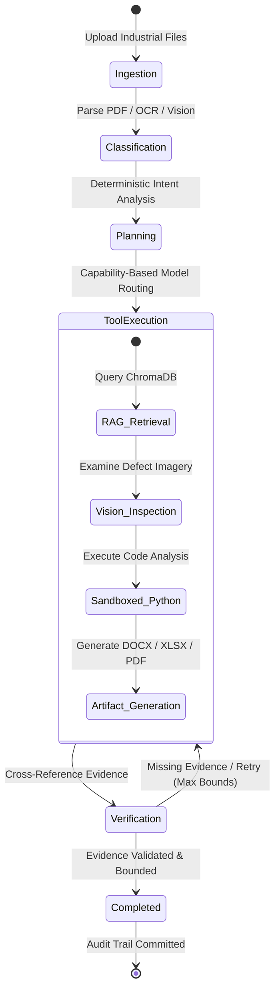

# 🛡️ Sovereign Industrial Agentic AI Workbench (SIH26117)

> **100% Self-Hosted, Air-Gapped Agentic AI Platform for Confidential Industrial & Defense Knowledge Work**  
> *Zero External Network Calls • Deterministic Model Routing • Bounded Agent State Machine • Local Multimodal RAG • Sandboxed Code Execution • Observable Sovereignty*

---

## 📑 Table of Contents

- [Overview & Mission](#-overview--mission)
- [Why Sovereign AI?](#-why-sovereign-ai)
- [System Architecture](#-system-architecture)
  - [High-Level Topology](#high-level-topology)
  - [Agent State Machine Workflow](#agent-state-machine-workflow)
- [The 5 Modular Pillars](#-the-5-modular-pillars)
  - [1. Platform & User Experience (`member-1-platform`)](#1-platform--user-experience-member-1-platform)
  - [2. Backend Core & API Gateway (`member-2-backend`)](#2-backend-core--api-gateway-member-2-backend)
  - [3. AI Core & Orchestration Engine (`member-3-ai`)](#3-ai-core--orchestration-engine-member-3-ai)
  - [4. Local RAG & Multimodal Intelligence (`member-4-rag-multimodal`)](#4-local-rag--multimodal-intelligence-member-4-rag-multimodal)
  - [5. Security, Sandboxing & Tool Registry (`member-5-security-integration`)](#5-security-sandboxing--tool-registry-member-5-security-integration)
- [Key Workflows Explained](#-key-workflows-explained)
  - [The Golden Workflow: Industrial Inspection & Report Compilation](#the-golden-workflow-industrial-inspection--report-compilation)
  - [The Secondary Workflow: Equipment Telemetry & Data Science](#the-secondary-workflow-equipment-telemetry--data-science)
- [Security & Sovereignty Guarantees](#-security--sovereignty-guarantees)
- [API Specification Reference](#-api-specification-reference)
- [Project Directory Structure](#-project-directory-structure)
- [Quick Start & Setup Guide](#-quick-start--setup-guide)
  - [Prerequisites](#prerequisites)
  - [Option A: One-Click Windows Launch](#option-a-one-click-windows-launch-recommended)
  - [Option B: Manual Developer Launch](#option-b-manual-developer-launch)
  - [Option C: Docker Stack Deployment](#option-c-docker-stack-deployment)
- [Verification & Integrity Testing](#-verification--integrity-testing)

---

## 🎯 Overview & Mission

In mission-critical industrial manufacturing, defense aerospace, public utilities, and confidential research, enterprise data cannot leave on-premises networks. Sending engineering schematics, maintenance SOPs, or equipment telemetry to public cloud AI APIs (such as OpenAI, Anthropic, or Google Cloud) violates operational security, regulatory compliance (ITAR, HIPAA, GDPR), and data sovereignty.

The **Sovereign Industrial Agentic AI Workbench** is a complete, production-grade, air-gapped system designed from the ground up to operate **100% locally**. It delivers an autonomous agentic experience—ingesting complex multi-page industrial PDFs, reading high-resolution inspection imagery, retrieving relevant maintenance SOPs, formulating multi-step reasoning plans, executing sandboxed data analysis, and generating executive Word (`.docx`), Excel (`.xlsx`), and PDF deliverables—while **guaranteeing zero data leakage to external networks**.

---

## 💡 Why Sovereign AI?

| Cloud AI Assistants (OpenAI / Anthropic) | Sovereign AI Workbench (This Platform) |
| :--- | :--- |
| ❌ Telemetry and proprietary documents sent to external servers | ✅ **100% On-Premise**: Every bit remains in your private hardware |
| ❌ Unpredictable pricing, token rate limits, and latency spikes | ✅ **Zero Recurring API Fees**: Runs on local Ollama / SLM hardware |
| ❌ Black-box execution and hidden prompt routing | ✅ **Deterministic Routing & Full Auditing**: Every tool call is verified |
| ❌ High risk of unverified hallucinations in critical SOPs | ✅ **Page-Grounded Retrieval**: Strict evidence citations mandatory |
| ❌ Unrestricted external connections | ✅ **Default-Deny Egress**: Hardened network boundary & sandbox isolation |

---

## 🏛️ System Architecture

### High-Level Topology

```
                                 [ USER WORKSTATION ]
                                          │
                                          ▼
                      ┌───────────────────────────────────────┐
                      │    Platform Web UI (React + Vite)     │
                      │  • Task Console      • Knowledge Base │
                      │  • Model Monitor     • Artifacts View │
                      │  • Security Dashboard• Audit Trace    │
                      └───────────────────┬───────────────────┘
                                          │ (Local HTTP / REST)
                                          ▼
                      ┌───────────────────────────────────────┐
                      │      FastAPI Gateway Boundary         │
                      │  • Async Task Queues  • File Service  │
                      │  • Security Envelope  • SQLite DB     │
                      └───────────────────┬───────────────────┘
                                          │
              ┌───────────────────────────┴───────────────────────────┐
              ▼                                                       ▼
┌───────────────────────────┐                           ┌───────────────────────────┐
│     Security & Audit      │                           │    Agent Orchestrator     │
│  • Network Egress Guard   │                           │     (LangGraph State)     │
│  • Tamper-Evident JSONL   │                           └─────────────┬─────────────┘
│  • Path Traversal Jail    │                                         │
└───────────────────────────┘                                         ▼
                                                        ┌───────────────────────────┐
                                                        │ Deterministic Classifier  │
                                                        │ (QA, Code, Vision, Report)│
                                                        └─────────────┬─────────────┘
                                                                      │
                                                                      ▼
                                                        ┌───────────────────────────┐
                                                        │       Model Router        │
                                                        │ (Qwen-Coder / Llama / LLaVA│
                                                        └─────────────┬─────────────┘
                                                                      │
                                                                      ▼
                                                        ┌───────────────────────────┐
                                                        │   Registered Tool Layer   │
                                                        └─────────────┬─────────────┘
                                                                      │
        ┌───────────────────┬───────────────────┬─────────────────────┴──────────────────┐
        ▼                   ▼                   ▼                                        ▼
┌──────────────┐    ┌──────────────┐    ┌──────────────┐                         ┌──────────────┐
│  Local RAG   │    │  Local OCR   │    │ Local Vision │                         │   Sandbox    │
│  • ChromaDB  │    │ • Tesseract  │    │ • LLaVA Local│                         │ • AST-Checked│
│  • Embeddings│    │ • PDF Scans  │    │ • Visual QA  │                         │ • Subprocess │
└──────────────┘    └──────────────┘    └──────────────┘                         └───────┬──────┘
                                                                                         │
                                                                                         ▼
                                                                                 ┌──────────────┐
                                                                                 │  Artifacts   │
                                                                                 │ .docx / .xlsx│
                                                                                 │ .pdf reports │
                                                                                 └──────────────┘
```

---

### Agent State Machine Workflow

The agent does not operate as an unpredictable, infinite-loop autonomous swarm. Instead, it follows a **bounded, deterministic state machine**:



1. **Ingest & Validate**: The file is scanned for security violations (path traversal, size, malware heuristics).
2. **Deterministic Classification**: Categorizes user intent (`document`, `coding`, `vision`, `general`).
3. **Model Routing**: Selects the optimal local model (e.g. `qwen2.5-coder` for scripts, `llama3.2` for logic, `llava` for visual defect analysis).
4. **Bounded Execution**: Maximum allowable steps prevent runaways or hallucinations.
5. **Verification**: Verifies that every claim is grounded with source citations before compiling final deliverables.
6. **Audit Sealing**: The entire trace is committed to an immutable append-only JSONL log.

---

## 🧱 The 5 Modular Pillars

The repository is architected across 5 specialized, decoupled member modules:

### 1. Platform & User Experience (`member-1-platform`)
- **Technology**: React 18, Vite, Vanilla CSS + Tailwind utility styling, Lucide icons.
- **Key Modules**:
  - `WorkbenchPage.jsx`: Real-time execution console displaying live agent thoughts, tool execution steps, and live progress bars.
  - `DocumentsPage.jsx`: Local upload manager with drag-and-drop file staging.
  - `KnowledgePage.jsx`: Vector search explorer to inspect chunking, embeddings, and similarity distances in ChromaDB.
  - `ArtifactsPage.jsx`: Deliverable center to preview and download generated `.docx`, `.xlsx`, and `.pdf` files.
  - `SecurityPage.jsx`: Live sovereignty dashboard providing real-time evidence of zero external network egress.
  - `HealthPage.jsx`: Infrastructure monitor for Ollama, ChromaDB, and backend services.

### 2. Backend Core & API Gateway (`member-2-backend`)
- **Technology**: Python 3.10+, FastAPI, Uvicorn, SQLite (WAL mode), Pydantic v2.
- **Key Services**:
  - `TaskService`: Orchestrates asynchronous task state, lifecycle bounds, and cancellation tokens.
  - `FileService`: Manages sandboxed file storage in `/workspace/uploads/` with UUID-based indexing.
  - `KnowledgeService`: Interfaces with vector indexing and semantic retrieval.
  - `ModelService`: Probes local Ollama and Transformer model availability and memory consumption.
  - `AuditService`: Collects structured lifecycle events into the tamper-evident log.

### 3. AI Core & Orchestration Engine (`member-3-ai`)
- **Technology**: LangGraph State Machine, Ollama API Client, Local Model Adapters.
- **Key Components**:
  - `classifier.py`: Deterministic intent parser using regex and token rules to eliminate hallucinated routing.
  - `router.py`: Capability-based router mapping tasks to registered local models (`reasoning`, `coding`, `vision`).
  - `planner.py`: Generates bounded execution plans with explicit tool preconditions.
  - `executor.py`: Safely invokes tools via the registered tool boundary.
  - `verifier.py`: Automated output consistency checks ensuring answers do not contradict source citations.
  - `injection_defense.py`: Heuristic scanner detecting prompt injection patterns in user documents.

### 4. Local RAG & Multimodal Intelligence (`member-4-rag-multimodal`)
- **Technology**: ChromaDB, `sentence-transformers` (`all-MiniLM-L6-v2`), PyPDF, `pytesseract`, Pillow.
- **Key Capabilities**:
  - `parser.py`: Multi-format parser for PDFs, Word documents, plain text, and CSVs.
  - `chunker.py`: Sliding-window semantic chunker maintaining context boundaries and page metadata.
  - `vector_store.py`: Local persistent ChromaDB instance storing document vectors.
  - `grounding.py`: Evidence verification attaching exact `[Document: Page X]` tags to retrieved context.
  - `engine.py` (OCR): Local Tesseract OCR engine for scanned technical schematics and blueprints.
  - `analyzer.py` (Vision): Multimodal vision pipeline executing local visual defect inspection.

### 5. Security, Sandboxing & Tool Registry (`member-5-security-integration`)
- **Technology**: Python AST Sandbox, Subprocess Isolation, `python-docx`, `openpyxl`, `reportlab`.
- **Key Hardening Features**:
  - `network_guard.py`: Kernel/Socket monitor enforcing zero outbound internet connectivity.
  - `path_validator.py`: Strict path canonicalization preventing directory traversal attacks (`../../`).
  - `run_python.py`: Sandboxed Python executor running code inside isolated subprocesses with restricted imports, memory limits, and strict 15-second execution timeouts.
  - `registry.py`: Central action boundary; models can only invoke explicitly registered, schema-validated tools:
    - `search_knowledge`: Queries local ChromaDB.
    - `read_file`: Reads authorized workspace files.
    - `calculator`: Precise arithmetic evaluation without code execution.
    - `run_python`: Isolated script execution.
    - `create_docx`: Generates formatted executive Word reports.
    - `create_xlsx`: Generates structured Excel spreadsheets.
    - `create_pdf`: Compiles formatted inspection summaries.
    - `analyze_image`: Multimodal visual inspection.

---

## 🔄 Key Workflows Explained

### The Golden Workflow: Industrial Inspection & Report Compilation

```
[Industrial Inspection PDF + Valve Photo + Maintenance SOP]
                             │
                             ▼
              1. Local Ingestion & Parsing
       (PyPDF extracts text; Tesseract OCR processes scans)
                             │
                             ▼
              2. Semantic Indexing & Grounding
      (Sentence-Transformers embeds chunks into local ChromaDB)
                             │
                             ▼
              3. Deterministic Task Classification
           (Identified as Multimodal Inspection Task)
                             │
                             ▼
              4. Local Multimodal Vision Analysis
         (Local LLaVA detects physical valve rust / wear)
                             │
                             ▼
              5. Local RAG Evidence Retrieval
     (Retrieves maintenance tolerance rules from SOP with page numbers)
                             │
                             ▼
              6. Evidence-Grounded Reasoning
     (Cross-references visual defect severity with SOP limits)
                             │
                             ▼
              7. Deliverable Compilation
         (Deterministic production of approval_note.docx)
                             │
                             ▼
              8. Verification & Audit Sealing
       (Zero external calls verified; Audit event committed)
```

---

### The Secondary Workflow: Equipment Telemetry & Data Science

```
[Industrial Sensor CSV (vibration, temperature, pressure)]
                             │
                             ▼
              1. Classification & Model Routing
    (Routed to local coding model, e.g., Qwen-2.5-Coder)
                             │
                             ▼
              2. Python Analysis Generation
    (Agent generates data cleaning and trend calculation code)
                             │
                             ▼
              3. Sandboxed Execution
 (Executed in network-disabled subprocess; AST restricts forbidden OS calls)
                             │
                             ▼
              4. Structured Excel Generation
       (openpyxl compiles telemetry_analysis.xlsx with charts)
                             │
                             ▼
              5. Verification & Download Available
```

---

## 🔒 Security & Sovereignty Guarantees

The workbench enforces a **Defense-in-Depth** model across 7 distinct security layers:

```
Layer 7: Runtime Network Monitor (Live egress tracking & dashboard alerts)
Layer 6: Local-Only Storage (All SQLite DBs, ChromaDB vectors, and artifacts stored locally)
Layer 5: Immutable Audit Logging (JSONL records with timestamps, hashes, and tool parameters)
Layer 4: Sandboxed Code Execution (AST verification, socket prohibition, execution limits)
Layer 3: Path Traversal Jail (All file accesses strictly confined to workspace directory)
Layer 2: Prompt Injection Defense (Adversarial pattern recognition on uploaded inputs)
Layer 1: Default-Deny Network Egress (Zero remote APIs allowed or contacted)
```

> **Verifiable Egress Guarantee**: During execution, the system monitors all network sockets. The Security Dashboard reports total outbound cloud AI calls as **0**, backed by concrete OS socket inspection.

---

## 📡 API Specification Reference

All endpoints adhere to the unified `/api/v1` contract:

| Method | Endpoint | Description | Request Body / Params |
| :--- | :--- | :--- | :--- |
| `POST` | `/api/v1/tasks` | Create a new agentic task | `{"instruction": "...", "file_ids": [...]}` |
| `POST` | `/api/v1/tasks/{id}/run` | Execute task asynchronously | None |
| `GET` | `/api/v1/tasks/{id}` | Poll task status, steps & artifacts | None |
| `POST` | `/api/v1/files` | Upload file to secure workspace | Multipart Form (`file`) |
| `POST` | `/api/v1/knowledge/index` | Chunk & embed file into ChromaDB | `{"file_id": "FILE-..."}` |
| `POST` | `/api/v1/knowledge/search` | Query local vector knowledge base | `{"query": "...", "top_k": 5}` |
| `GET` | `/api/v1/models` | List detected local Ollama / SLM models | None |
| `GET` | `/api/v1/health` | Comprehensive system health check | None |
| `GET` | `/api/v1/security/status` | Real-time sovereignty & network evidence | None |
| `GET` | `/api/v1/audit/tasks/{id}` | Retrieve tamper-evident task audit logs | None |
| `GET` | `/api/v1/artifacts/{id}` | Download generated report (`.docx`, etc.) | None |

---

## 📂 Project Directory Structure

```plaintext
SIH26117_Sovereign_AI_Workbench/
├── MASTER/                           # System architecture specifications & contracts
│   ├── 00_PROJECT_CHARTER.md         # Project charter & non-negotiables
│   ├── 01_MASTER_ARCHITECTURE.md     # Single source of architectural truth
│   ├── 02_MODULE_CONTRACTS.md        # 5-member ownership boundaries
│   ├── 03_API_CONTRACTS.md           # REST API schema definitions
│   ├── 04_DATA_SCHEMAS.md            # Canonical Pydantic schemas
│   ├── 05_MODEL_CONTRACT.md          # Local model interfaces & capabilities
│   ├── 06_AGENT_CONTRACT.md          # LangGraph state machine contract
│   ├── 07_TOOL_CONTRACT.md           # Tool registry definitions
│   ├── 08_RAG_CONTRACT.md            # Vector search & citation rules
│   ├── 09_SECURITY_SOVEREIGNTY.md    # Egress denial & sandbox rules
│   └── 13_DEMO_WORKFLOW.md           # Step-by-step test workflows
├── member-1-platform/                # Module 1: Web Frontend
│   └── frontend/
│       ├── src/
│       │   ├── pages/                # Workbench, Docs, Knowledge, Security, Artifacts
│       │   ├── components/           # Reusable UI controls, logs, tables
│       │   └── services/             # Axios API client bindings
│       ├── package.json
│       └── vite.config.js
├── member-2-backend/                 # Module 2: Core API & Data Plane
│   └── backend/
│       ├── api/v1/                   # FastAPI route controllers
│       ├── services/                 # Database, Task, File, Health services
│       ├── schemas/                  # Request / Response validation
│       └── main.py                   # FastAPI application entrypoint
├── member-3-ai/                      # Module 3: AI Engine & Orchestrator
│   └── backend/
│       ├── agents/                   # Classifier, Planner, Executor, Verifier
│       └── models/                   # Ollama adapters, ModelRouter, Local registry
├── member-4-rag-multimodal/          # Module 4: Local RAG & Computer Vision
│   └── backend/
│       ├── rag/                      # Chunker, Embeddings, ChromaDB store, Retriever
│       ├── ocr/                      # Tesseract OCR engine for scanned files
│       └── vision/                   # Local LLaVA multimodal image analyzer
├── member-5-security-integration/    # Module 5: Security, Tools & Sandboxing
│   ├── backend/
│   │   ├── security/                 # Egress guard, Path traversal jail, Audit log
│   │   └── tools/                    # Tool registry, Python sandbox, DOCX/XLSX engines
│   ├── docker/                       # Dockerfile & Docker Compose definitions
│   └── integration/                  # End-to-end multi-module verification suite
├── sample_data/                      # Demonstration industrial files
│   ├── equipment_telemetry.csv       # Sensor readings for data analysis
│   ├── inspection_report.pdf         # Technical inspection report
│   ├── maintenance_sop.txt           # Standard Operating Procedure guidelines
│   └── valve_inspection_photo.jpg    # Industrial equipment photo
├── AGENTS.md                         # Coding agent operational constraints
├── ARCHITECTURE_DECISIONS.md         # Canonical Architectural Decision Records (ADRs)
├── requirements.txt                  # Python dependencies (Air-gapped local stack)
├── start.bat                         # Interactive 1-click Windows launcher
└── .gitignore                        # Standard exclusions
```

---

## 🚀 Quick Start & Setup Guide

### Prerequisites

1. **Python 3.10+** (64-bit)
2. **Node.js 18+** & **npm**
3. **Ollama** installed locally ([Download Ollama](https://ollama.ai/))
   - Recommended local models:
     ```bash
     ollama pull llama3.2:3b
     ollama pull qwen2.5-coder:7b
     ollama pull llava:7b
     ```
4. *(Optional)* **Tesseract OCR** for scanned PDF blueprints

---

### Option A: One-Click Windows Launch (Recommended)

Simply double-click or run:
```cmd
start.bat
```
Select **`[1] Start Full Workbench`** from the interactive menu.  
The launcher will automatically:
- Configure all 5 module paths in `PYTHONPATH`
- Launch the FastAPI Backend on `http://127.0.0.1:8000`
- Launch the Vite Frontend on `http://localhost:3000`
- Open your default browser directly to the Workbench UI

---

### Option B: Manual Developer Launch

#### 1. Install Dependencies
```bash
# Install Python packages
pip install -r requirements.txt

# Install Frontend dependencies
cd member-1-platform/frontend
npm install
cd ../..
```

#### 2. Configure Python Path
Ensure all 5 member modules are included in your environment:
```bash
# Windows PowerShell
$env:PYTHONPATH = "$PWD/member-2-backend;$PWD/member-3-ai;$PWD/member-4-rag-multimodal;$PWD/member-5-security-integration"

# Linux / macOS
export PYTHONPATH="$PWD/member-2-backend:$PWD/member-3-ai:$PWD/member-4-rag-multimodal:$PWD/member-5-security-integration"
```

#### 3. Start Backend
```bash
python -m uvicorn backend.main:app --host 127.0.0.1 --port 8000 --reload
```
API Documentation will be live at: `http://127.0.0.1:8000/docs`

#### 4. Start Frontend
```bash
cd member-1-platform/frontend
npm run dev
```
Open `http://localhost:3000` in your web browser.

---

### Option C: Docker Stack Deployment

To run the entire workbench within isolated containers:
```bash
cd member-5-security-integration/docker
docker-compose up --build
```
This boots:
- `backend`: FastAPI API server with egress restrictions
- `frontend`: Built React static UI
- `chromadb`: Persistent vector store
- `ollama`: Local model runtime container

---

## 🧪 Verification & Integrity Testing

The project includes a comprehensive, cross-module integration test suite to verify that all 5 modules communicate cleanly through their defined contracts:

```bash
# Run full system verification
python member-5-security-integration/integration/run_all_modules_check.py
```

This automated test validates:
1. ✅ **FastAPI Route Registry**: Confirms all 11 core endpoints are mounted.
2. ✅ **Model Router & Fallback**: Validates capability matching.
3. ✅ **Local RAG Pipeline**: Ingests, chunks, embeds, and performs similarity searches.
4. ✅ **Python Sandbox**: Confirms isolated code execution and safety blocking.
5. ✅ **Artifact Generation**: Verifies compilation of `.docx` and `.xlsx` files.
6. ✅ **Security Boundary**: Verifies that network egress attempts are intercepted and recorded.

---

## 📄 License & Sovereignty Notice

This project was developed for **Smart India Hackathon (SIH 26117)**. All code and documentation are provided for sovereign, on-premise industrial AI research and deployment. No proprietary cloud dependencies or unauthorized data collection mechanisms are included.
